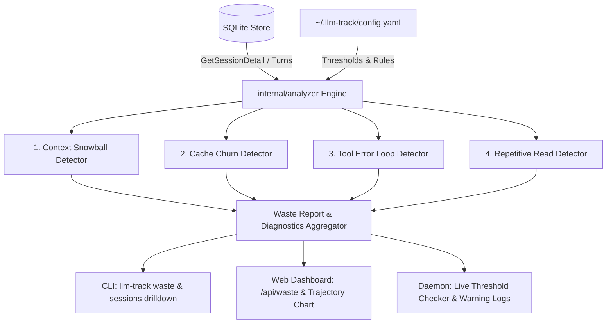

# Context Bloat & Token Waste Optimization Engine Design Spec

## 1. Overview & Objectives

In agentic workflows and multi-turn coding assistants (Claude Code, AGY, Cursor, Windsurf, Roo Code, etc.), multi-turn sessions frequently suffer from severe context bloat and token waste. This occurs via:
1. **Context Snowballing**: Conversation histories growing quadratically, causing late turns to consume the vast majority of tokens and budget.
2. **Cache Churn / Cache Invalidation**: Sudden drops in prompt caching hit rates on large prompt contexts.
3. **Tool Error Loops**: Consecutive failed tool executions (e.g. failing tests, linter loops) re-transmitting large context windows without progress.
4. **Repetitive File Reads**: Idempotent file/grep ingestion reading identical context without intermediate modifications.

### Goals
- **Non-Invasive & Zero Schema Migration**: Analyze existing data directly from `store.Store` using a dedicated in-memory heuristics engine (`internal/analyzer`).
- **Comprehensive Waste Diagnostics**: Calculate estimated avoidable tokens ($T_{\text{waste}}$) and avoidable USD ($\$_{\text{waste}}$) per session and aggregated by period.
- **Multi-Channel Surfaces**:
  - **CLI**: New `llm-track waste` command and waste badges in `llm-track sessions <id>`.
  - **Web Dashboard**: New `GET /api/waste` and `GET /api/sessions/{id}/waste` API endpoints, waste KPI cards, and step-by-step context growth trajectory charts.
  - **Daemon**: Threshold monitoring and warning logs in `internal/daemon` for active sessions exceeding token boundaries or error loop limits.

---

## 2. Architecture & System Flow



### Component Structure
- **`internal/analyzer/`**:
  - `analyzer.go`: Core interfaces and orchestrator function `AnalyzeSession()`, `AnalyzePeriod()`.
  - `models.go`: Analysis structs (`SessionWasteAnalysis`, `WasteFinding`, `PeriodWasteSummary`, `TurnMetric`).
  - `snowball.go`: Context snowballing and exponential growth detection.
  - `cache_churn.go`: Cache hit drop and invalidation cost evaluation.
  - `error_loop.go`: Consecutive tool execution failure tracking.
  - `analyzer_test.go`: Comprehensive unit tests on realistic session fixtures.
- **`internal/cli/`**:
  - `waste.go`: Cobra command `llm-track waste [--period=today|week|month|all]`.
  - `sessions.go`: Modified to display health score and waste warnings in `llm-track sessions <id>`.
- **`internal/dashboard/`**:
  - `handlers.go`: Handlers for `GET /api/waste` and `GET /api/sessions/{id}/waste`.
  - `static/app.js`: Chart.js rendering for context trajectory curves and waste KPI display.
  - `static/index.html` & `style.css`: UI components for waste diagnostics.
- **`internal/daemon/`**:
  - `daemon.go`: Integrated live session turn threshold check during sync cycles.

---

## 3. Data Structures & Heuristic Formulas

### Models (`internal/analyzer/models.go`)

```go
package analyzer

import (
	"time"
)

type WasteCategory string

const (
	WasteContextSnowball WasteCategory = "context_snowball"
	WasteCacheChurn      WasteCategory = "cache_churn"
	WasteErrorLoop       WasteCategory = "tool_error_loop"
	WasteRepetitiveRead  WasteCategory = "repetitive_read"
)

type WasteSeverity string

const (
	SeverityLow      WasteSeverity = "low"
	SeverityMedium   WasteSeverity = "medium"
	SeverityHigh     WasteSeverity = "high"
	SeverityCritical WasteSeverity = "critical"
)

type WasteFinding struct {
	Category       WasteCategory `json:"category"`
	Severity       WasteSeverity `json:"severity"`
	TurnIndex      int64         `json:"turn_index"`
	WastedTokens   int64         `json:"wasted_tokens"`
	WastedUSD      float64       `json:"wasted_usd"`
	Explanation    string        `json:"explanation"`
	Recommendation string        `json:"recommendation"`
}

type TurnMetric struct {
	StepIndex       int64   `json:"step_index"`
	InputTokens     int64   `json:"input_tokens"`
	OutputTokens    int64   `json:"output_tokens"`
	CacheReadTokens int64   `json:"cache_read_tokens"`
	CostUSD         float64 `json:"cost_usd"`
	HasToolError    bool    `json:"has_tool_error"`
	IsWaste         bool    `json:"is_waste"`
}

type SessionWasteAnalysis struct {
	SessionID       string         `json:"session_id"`
	Tool            string         `json:"tool"`
	TotalTokens     int64          `json:"total_tokens"`
	TotalCost       float64        `json:"total_cost"`
	WastedTokens    int64          `json:"wasted_tokens"`
	WastedUSD       float64        `json:"wasted_usd"`
	WastePercentage float64        `json:"waste_percentage"`
	HealthScore     int            `json:"health_score"` // 0-100 (100 = optimal, 0 = critical waste)
	Findings        []WasteFinding `json:"findings"`
	Trajectory      []TurnMetric   `json:"trajectory"`
}

type PeriodWasteSummary struct {
	Period           string                 `json:"period"`
	TotalSessions    int64                  `json:"total_sessions"`
	WastedSessions   int64                  `json:"wasted_sessions"`
	TotalWastedUSD   float64                `json:"total_wasted_usd"`
	TotalWastedToks  int64                  `json:"total_wasted_tokens"`
	AvgHealthScore   float64                `json:"avg_health_score"`
	TopWasteSessions []SessionWasteAnalysis `json:"top_waste_sessions"`
	CategoryTotals   map[WasteCategory]float64 `json:"category_totals_usd"`
}
```

### Detection Heuristics & Mathematical Formulas

1. **Context Snowball Detector**:
   - **Trigger**: Total turns $N \ge 8$. If the final $25\%$ of turns account for $\ge 60\%$ of total session cost and input tokens exceed `SnowballTokenThreshold` (default $80,000$ tokens), or any single turn context exceeds $120,000$ tokens.
   - **Wasted Tokens Formula**:
     $$\text{WastedTokens} = \sum_{t \in \text{LateTurns}} \max(0, T_{\text{in}}(t) - T_{\text{median\_early}})$$
   - **Cost Allocation**: Pro-rated based on turn model input token cost.

2. **Cache Churn Detector**:
   - **Trigger**: Baseline cache hit rate across preceding turns $\ge 60\%$. In subsequent turn $k$, cache hit rate drops below $25\%$ while $T_{\text{in}}(k) \ge 20,000$ tokens.
   - **Wasted USD Formula**:
     $$\text{WastedUSD} = \frac{T_{\text{miss}}(k) - (T_{\text{in}}(k) \times \text{ExpectedHitRate})}{10^6} \times (\text{Price}_{\text{miss}} - \text{Price}_{\text{cache\_read}})$$

3. **Tool Error Loop Detector**:
   - **Trigger**: Consecutive turns $k, k+1, \dots$ where `tool_error_count > 0` (or failure status) $\ge 2$ consecutive turns.
   - **Wasted Tokens & Cost**: Sum of $T_{\text{in}} + T_{\text{out}}$ and total turn cost across all repeated failure steps after the first failure.

4. **Health Score Formula**:
   $$\text{HealthScore} = \max\left(0, \min\left(100, 100 - (\text{WastePercentage} \times 1.25) - (\text{CriticalFindingCount} \times 20)\right)\right)$$

---

## 4. Configuration Schema (`config.yaml`)

```yaml
waste_monitoring:
  enabled: true
  snowball_token_threshold: 80000
  severe_turn_token_threshold: 120000
  warn_consecutive_tool_errors: 3
  cache_churn_drop_threshold: 0.40 # 40% sudden drop
  log_alerts_to_console: true
```

---

## 5. CLI & Web UI Specification

### CLI: `llm-track waste`
- Accepts `--period=today|week|month|all` (default: `today`).
- Displays period aggregate totals: Avoidable USD, Wasted Tokens, Flagged Session count, and Average Health Score.
- Displays ranked table: Rank, Tool, Session ID, Total Cost, Waste USD, Waste %, Health Score, Primary Issue.
- Displays top actionable recommendations.

### CLI: `llm-track sessions <id>`
- Displays a `[Waste & Health Analysis]` summary above the turn table when findings exist.

### Web Dashboard
- **Waste Tab / Overview Card**:
  - Metric cards: "Estimated Avoidable Spend" and "Average Session Health".
  - Waste category breakdown pie/bar chart (Snowball vs. Error Loops vs. Cache Churn).
- **Session Trajectory Modal Chart**:
  - Line chart showing $T_{\text{in}}$ across turns $1 \dots N$.
  - Waste steps highlighted with colored visual flags.

---

## 6. Testing & Quality Gates

- **Unit Testing (`internal/analyzer`)**:
  - Test snowball detection with synthetic linear vs. exponential turn series.
  - Test cache churn calculation when hit rate drops sharply.
  - Test tool error loop detection with alternating vs. consecutive error patterns.
  - Zero-turn, single-turn, and zero-token edge cases return zero-valued analysis without divide-by-zero or panics.
- **CLI Testing (`internal/cli`)**:
  - Verify `llm-track waste` output formatting and flag handling.
  - Verify `llm-track sessions <id>` displays waste badges.
- **Dashboard API Testing (`internal/dashboard`)**:
  - Test `GET /api/waste` and `GET /api/sessions/{id}/waste` response codes and payload structures.
- **Performance & Regressions**:
  - Ensure `AnalyzePeriod` computes in $< 50\text{ms}$ for 500 session turns.
  - Full test suite passes: `go test -race ./...`.
